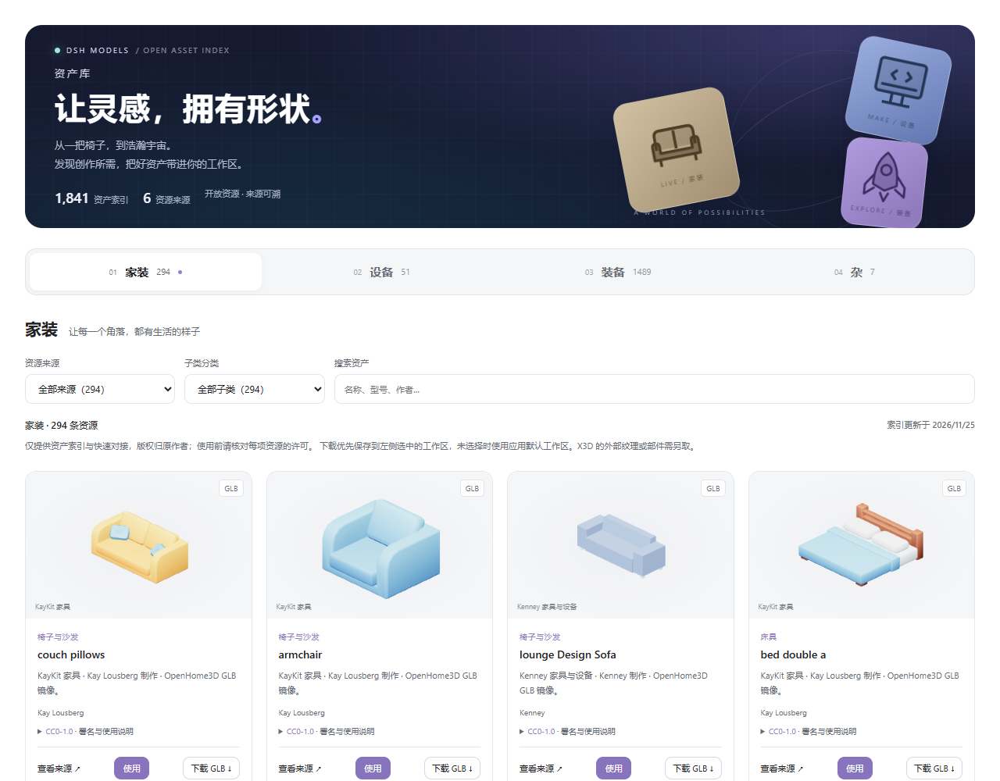

# dsh-models

English · [简体中文](README.md)

A 3D asset library for DeepSeek Harness (DSH). Browse and search models, check their source and license, preview them in an interactive local viewer, and download the original files to your workspace.

<p align="center">
  <picture>
    <source media="(prefers-color-scheme: dark)" srcset="docs/images/readme/library-desktop-dark.png">
    
  </picture>
</p>

## Browse, preview, and download

1. Browse Furniture, Devices, Equipment, or Miscellaneous. Filter by source, subcategory, or keyword.
2. Open an asset card to check the author, license, attribution, and original source.
3. Choose **Use** to open the local Three.js preview, or **Download** to save the original GLB or X3D file to the workspace.

The November 25, 2026 index contains **1,841 assets from six sources**, including NPS SAVAGE, NASA, Kenney, KayKit, and selected Khronos samples. The plugin distributes the index and thumbnails. Individual model files come from their original sources or pinned mirrors when requested. Check the license on each asset. See the [source and license notices](third-party/github/NOTICE.md).

Downloads use the selected session's workspace, or the configured default when no session workspace is selected. They are stored under `models/SAVAGE/` or `models/GitHub/`. Each download includes a `.source.json` record and existing files are preserved.

The viewer supports orbit, zoom, pan, and reset. SAVAGE previews use a corresponding VRML97 scene when one is available and compatible. Downloads still preserve the original X3D file. See the [viewer notices](third-party/VIEWER-NOTICE.md).

## Build and install

Requires Node.js `^22.19.0 || >=24.0.0`. Python 3 is used for catalog maintenance.

```sh
npm ci --ignore-scripts
npm test
npm run pack:release
```

Install the resulting `dist/dsh-models-<version>.tgz` in DSH. Seal Harness uses the same prebuilt package and the public `dsh-models/client-api` entry to register its panel. See the [Chinese README](README.md) for catalog synchronization, installation details, and verification commands.

## MCP

The prebuilt package includes a standard stdio server.

```json
{
  "mcpServers": {
    "dsh_models": {
      "command": "node",
      "args": ["<absolute plugin path>/lib/mcp.cjs", "--workspace", "<absolute workspace path>"]
    }
  }
}
```

Use `assets_catalog`, `assets_search`, and `assets_get` to find and inspect assets. Use `assets_download` to save an original file, or `assets_use` to start a viewer task. Open the returned viewer URL and check `assets_status` for the first rendered frame. Use `assets_cancel` to stop a task.
