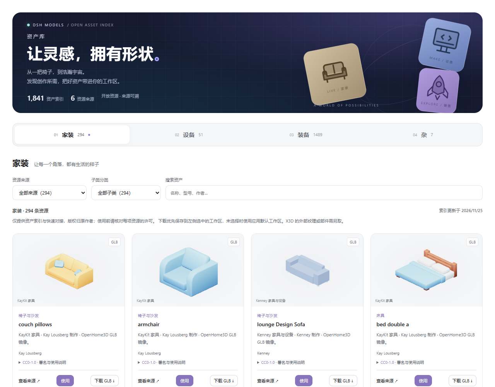
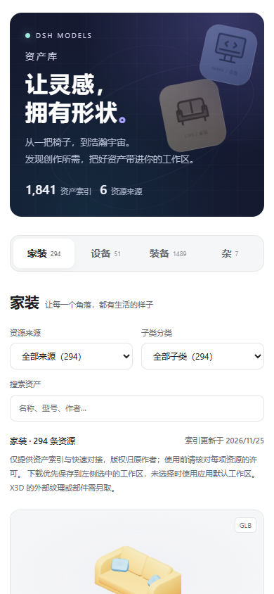

<div align="center">

<h1>dsh-models</h1>
<p><strong>让灵感，拥有形状。</strong></p>
<p><strong>为 DSH 打开一座可检索、可预览、可溯源的三维资产库。</strong><br>从一把椅子，到浩瀚宇宙；找到合适的模型，再带进当前工作区。</p>
<p><strong>1,841 项资产</strong> &middot; <strong>6 个资源来源</strong> &middot; GLB / X3D &middot; 本地 3D 查看器</p>
<p><a href="#产品预览">产品预览</a> &middot; <a href="#如何使用">如何使用</a> &middot; <a href="#页面与来源">资产来源</a> &middot; <a href="#开发同步和打包">开发与打包</a> &middot; <a href="#mcp">MCP 工具</a></p>

</div>

---

## 产品预览

<p align="center">
  <picture>
    <source media="(prefers-color-scheme: dark)" srcset="docs/images/readme/library-desktop-dark.png">
    
  </picture>
</p>

<p align="center"><sub>实际插件界面的独立浏览器渲染截图。模型库嵌入 DSH 右侧面板；资源数对应 2026-11-25 的索引。</sub></p>

<details>
<summary>查看窄屏布局</summary>

<p align="center">
  <picture>
    <source media="(prefers-color-scheme: dark)" srcset="docs/images/readme/library-mobile-dark.png">
    
  </picture>
</p>

</details>

## 如何使用

1. **发现**：在家装、设备、装备、杂四个页签里浏览，按来源、子类或关键词缩小范围。
2. **核对**：打开模型卡片上的来源和署名信息，确认具体资产的许可与使用要求。
3. **取用**：点击“下载 GLB / X3D”保存原始文件到当前工作区；点击“使用”在内置 Three.js 查看器中检查实际模型。

这是独立的 DSH 插件。业务源码、静态索引和缩略图仅在本工程维护；Seal Harness 引用完整预编译包与公开 `client-api`，完整界面在右侧呈现，左侧导航保持不变。目前尚未发布 GitHub Release 或 npm 包；开发者可按下方步骤从源码打包。

## 页面与来源

顶部广告牌与 slogan：**让灵感，拥有形状。** 四个页签：

| 页签 | 内容 | 当前资源数 |
| --- | --- | ---: |
| 家装 | 桌椅、沙发、床、柜架、灯具、卫浴与装饰 | 294 |
| 设备 | 电脑键鼠、家电、电炉、音响、工具与厨具 | 51 |
| 装备 | 原有 NPS SAVAGE 1233 项 + NASA 256 项 | 1489 |
| 杂 | 动物、食物与其他日常道具 | 7 |

每页支持来源、子类和关键词筛选。共 **1841 项资产、6 个资源来源**（2026-11-25 索引）；资源可能是完整物件、零部件、场景或工具，不等同于完整装备清单。NASA 原始仓库部分 GLB 不在 3D Models 目录，不属于当前收录范围。

- NPS SAVAGE：https://savage.nps.edu/Savage/ ，保留逐项作者、许可与原始 X3D。
- NASA：https://github.com/nasa/NASA-3D-Resources ，原始 GLB 和源站预览；遵守 NASA 媒体使用规范，不暗示背书，具体资源还须核对第三方权利。
- Kenney Furniture Kit：https://kenney.nl/assets/furniture-kit ，CC0，GLB 使用 OpenHome3D 的 GitHub 固定版本镜像。
- KayKit Furniture / Restaurant Bits：Kay Lousberg 原作，CC0，使用同一 GitHub 镜像。保留资产目录原始 LICENSE，不用应用的 MIT 许可替代模型许可。
- Khronos：https://github.com/KhronosGroup/glTF-Sample-Assets ，15 项逐项审计的精选 GLB，仅接入全部权利项为 CC0 或 CC BY 4.0 的资源。作者及贡献范围、原始作品链接、许可均保留。

完整来源和使用规范见 [third-party/github/NOTICE.md](third-party/github/NOTICE.md)。资产和图片权利归原作者；插件仅提供索引与快速对接渠道，不是资产权利授予者。模型不随插件分发，不转换 GLB；SAVAGE 外部纹理与部件需另取。337 张 CC0 家具/设备缩略图由对应 GLB 实际渲染，其余使用源站图片；缺图显示占位。

## 下载到工作区

点击“下载 GLB / X3D”后，由当前应用 Host 保存：优先左侧当前主视图会话所属工作区，没有选择才调用应用 workspaceController.initializeDefault 取得登记默认工作区。均不可用时提示先选择；失效的选中项报错，不悄悄换目录。

- SAVAGE：`<工作区>/models/SAVAGE/<分类和源目录>/<文件名>.x3d`。
- GitHub：`<工作区>/models/GitHub/<来源>/<文件名>.glb`。
- 卡片显示实际保存路径，同名文件加序号、不覆盖；同时保存 `<文件名>.source.json`，保留作者、来源、固定版本、许可和署名要求。

仅 owner 连接可通过 `/dsh-models` RPC 下载索引资源，不接受客户端 URL 或目标路径。请求限时 120 秒、上限 256 MB，验证 X3D 根节点或 GLB 2.0 头及文件长度，失败、取消、卸载不发布损坏文件，清理临时内容。只下载原始单文件，不自动解压、执行或递归抓取依赖。

## 开发、同步和打包

Node `^22.19.0 || >=24.0.0`，Python 3；包版本 0.1.4，保持 private，不发布 npm。

```powershell
npm ci --ignore-scripts
py -3 scripts/sync-savage.py --help
py -3 scripts/sync-github.py --cache-dir .build/github-cache
node scripts/render-thumbnails.mjs
npm test
py -3 tests/test_sync_savage.py
npm run verify:browser
npm run pack:release
```

GitHub 同步脚本以固定 commit 读取 tree 和逐项 metadata/许可，生成 `src/github-catalog.json` 与 `third-party/github` 证据；失败保留旧索引。刷新来源版本应先审查资源许可和分类规则。运行时只读取本地索引，不爬全站；原始模型只在用户下载时取得。Three.js 作为构建依赖生成缩略图，并编入本地查看器；安装环境无需另外下载 Three.js。

完整包为 `dist/dsh-models-0.1.4.tgz`，附 JSON 与 SHA-256。包含 Host、原生客户端、公开 client-api.cjs、bundle、缩略图与第三方许可；不含 src、构建脚本或开发依赖，安装不编译。未发布 GitHub Release 或新桌面安装器。

## 接入

原生 DSH 安装完整 tgz 后通过 bundle 加载 sidebar.panellist/main。原生 Loader 第二参为同步配置，`src/client.jsx` 只转发 ctx。宿主定制导航使用 `dsh-models/client-api` 的 apply(ctx, {registerPanel})，公开依赖经 inject 提供；Seal 只负责完整包解析、版本核对和右侧面板注册。

源码：https://github.com/asun-labs/dsh-models 。原生 DSH 0.2.3-alpha.2、Seal 0.2.2-rc.3 为当前 Windows 验收环境；跨平台安装和运行结果应分别记录。
## 内置 Three.js 查看器与智能体（0.1.4）

每张可下载卡片新增“使用”。点击后右侧进入本地浏览器查看页面，显示真实下载字节、文件大小已知时的百分比；大小未知或解析中显示不定进度。GLTFLoader / VRMLLoader 解析出实际网格、材质资源完成并渲染首帧后才标记“已加载”。支持轨道旋转、滚轮缩放、右键平移与重置视角；远处辅助对象使主体过小时默认聚焦主体，可切换完整场景；返回列表保留筛选，取消会撤销本次任务；卸载会停止任务并关闭自己的本地服务，已下载文件保留。

本地查看器随完整包交付，不依赖开发服务器、外网 CDN 或系统转换器。回环 HTTP 使用随机端口和任务独有能力地址，只提供该任务固定资源，不提供任意文件浏览。链接仅用于当前本机和当前任务，不应公开传播。

SAVAGE 仍保存原始 X3D；从详情页实际 href 读取对应 VRML97，按文件中的真实引用取得同源 Inline 子场景和安全位图。预览最多 8 层、64 个场景文件、32 张纹理、总依赖 128 MB，展开后最多 32 MB；循环、外域、PROTO/EXTERNPROTO、缺图和其他不兼容明确报错。脚本和 ROUTE 不执行，普通“下载”仍只取原始单文件。派生预览另存并附修改及依赖来源记录。M1A1 和 F-16 的静态预览经过实际验证，不代表全部 SAVAGE 交互逻辑得到支持。

### MCP

完整包提供标准 stdio 入口：

```json
{
  "mcpServers": {
    "dsh_models": {
      "command": "node",
      "args": ["<插件绝对目录>/lib/mcp.cjs", "--workspace", "<工作区绝对目录>"]
    }
  }
}
```

原生 DSH 加载插件后，为新建/恢复的智能体会话使用官方 MCP client 挂载，工作区来自该会话 workingDirectory.ensure；不同会话的任务不能互查或取消。Electron 仅在 MCP 子进程局部设置 ELECTRON_RUN_AS_NODE=1，不修改主进程全局环境。插件卸载及会话释放会关闭自己的 MCP 子进程；MCP 不接受工具参数提供任意 URL、目录或 shell。

工具：`assets_catalog`、`assets_search`、`assets_get`、`assets_download`、`assets_use`、`assets_status`、`assets_cancel`。DSH 名称前缀为 `mcp__dsh_models__`。`assets_use` 返回任务 ID 与 viewerUrl，需打开查看器再读取状态；downloaded 不等于 ready。使用者可通过现有浏览器能力打开链接，或由用户点击，不自动抢前台。

### 技能与验收

技能随包位于 `lib/skills/dsh-models-use/SKILL.md`，通过公开 skills.register 注册到原生技能服务，也可通过 MCP 的 `dsh-models://skills/dsh-models-use` 资源读取。它指导检索、逐项许可核对、下载、打开本地查看器及实际首帧验证，不替代工具。

```powershell
npm test
npm run verify:viewer
node lib/mcp.cjs --help
```

`verify:viewer` 使用实际 stdio MCP 与无头 Chromium，验证家具 GLB、NASA GLB、M1A1 与 F16 的首帧、网格、旋转缩放、重置及取消；不会操作用户鼠标焦点。第三方运行库原始许可和内嵌解析器 NOTICE 见 third-party/VIEWER-NOTICE.md。
